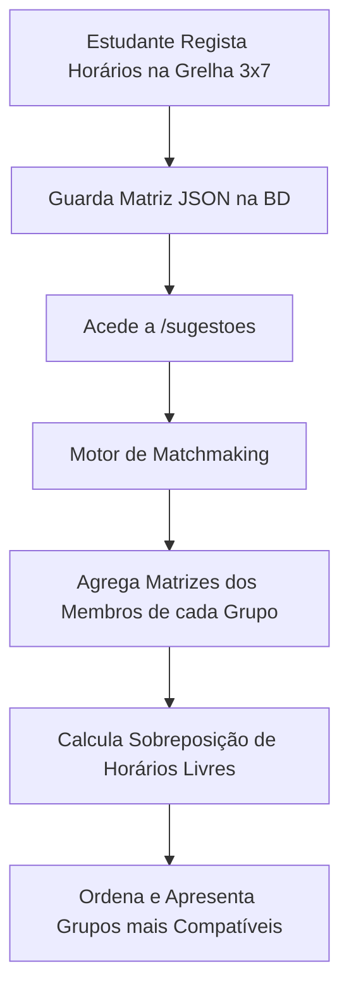

# 🏛️ Visão Geral da Arquitetura do Sistema

| Metadado | Informação |
| :--- | :--- |
| **Autor(a)** | Equipa de Desenvolvimento |
| **Data de Criação** | 2026-08-22 |
| **Última Atualização** | 2026-08-22 |
| **Versão** | 1.0.0 |
| **Módulo** | Arquitetura Geral |

---

## 🎯 1. Visão do Produto
O **Study Group Matcher** é uma plataforma que conecta estudantes universitários com base no seu curso, estilo de aprendizagem e horários livres, facilitando a formação de grupos de estudo eficientes.

---

## 🧩 2. Stack Tecnológica
* **Backend:** Python 3 + Flask 3.0
* **Segurança / Hashing:** Werkzeug Security (`generate_password_hash`, `check_password_hash`)
* **Base de Dados:** MySQL 8.0 + `mysql-connector-python`
* **Templates / Renderização:** Jinja2
* **Frontend:** Vanilla HTML5, CSS3 Moderno (CSS Custom Properties), Vanilla JavaScript
* **Variáveis de Ambiente:** `python-dotenv`

---

## 🔄 3. Fluxo de Dados e Algoritmo de Matchmaking

### Lógica da Matriz de Disponibilidade ($3 \times 7$)
A semana é dividida em:
* **3 Períodos diários:** Manhã ($M$), Tarde ($T$), Noite ($N$).
* **7 Dias:** Segunda a Domingo ($S, T, Q, Q, S, S, D$).
* **Valores de Célula na Comparação:**
  * `0`: Bloco indisponível / Ninguém
  * `1`: Utilizador disponível
  * `2`: Grupo disponível
  * `3`: Ambos disponíveis (**Hora em Comum**)

