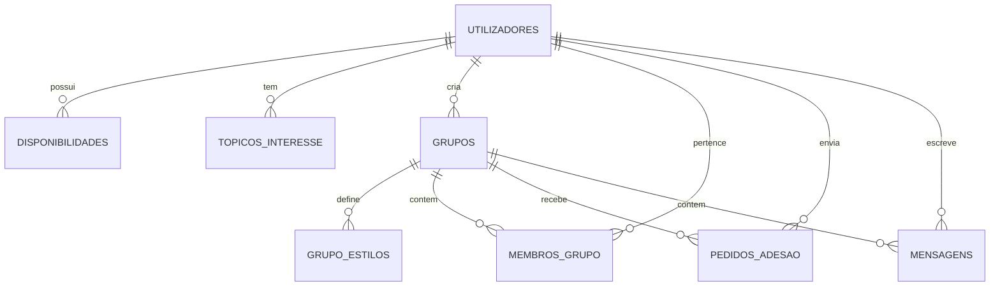

# 🗄️ Dicionário de Dados e Esquema Relacional

| Metadado | Informação |
| :--- | :--- |
| **Autor(a)** | Equipa de Desenvolvimento |
| **Data de Criação** | 2026-08-22 |
| **Última Atualização** | 2026-08-22 |
| **Versão** | 1.0.0 |
| **Módulo** | Base de Dados Relacional |

---

## 📊 1. Diagrama Entidade-Relacionamento

---

## 📋 2. Tabelas e Descrição dos Campos

### `utilizadores`
Guarda as contas dos estudantes.

| Campo | Tipo | Nulo | Descrição |
| :--- | :--- | :--- | :--- |
| `id` | `INT` | NÃO | Chave Primária (Auto-incremento). |
| `nome` | `VARCHAR(100)` | NÃO | Nome completo do utilizador. |
| `email` | `VARCHAR(150)` | NÃO | Email único de acesso. |
| `senha_hash` | `VARCHAR(255)` | NÃO | Palavra-passe encriptada (Werkzeug hash). |
| `curso` | `VARCHAR(100)` | NÃO | Curso em que está matriculado. |
| `ano` | `VARCHAR(10)` | SIM | Ano curricular (ex: `1.º`, `2.º`, etc.). |
| `estilo_estudo_pref`| `VARCHAR(50)` | SIM | Estilo preferido (`em_grupo`, `individual`, etc.). |
| `disponibilidade_matriz` | `JSON` | SIM | Matriz semanal $3 \times 7$ em formato JSON. |
| `criado_em` | `TIMESTAMP` | NÃO | Data de registo da conta. |

---

### `grupos`
Grupos de estudo criados pelos utilizadores.

| Campo | Tipo | Nulo | Descrição |
| :--- | :--- | :--- | :--- |
| `id` | `INT` | NÃO | Chave Primária. |
| `nome` | `VARCHAR(100)` | NÃO | Nome do grupo. |
| `objetivo` | `TEXT` | NÃO | Descrição dos objetivos do grupo. |
| `disciplina` | `VARCHAR(100)` | NÃO | Disciplina foco de estudo. |
| `criador_id` | `INT` | NÃO | FK para `utilizadores(id)`. |
| `max_membros` | `INT` | NÃO | Limite máximo de elementos (Padrão: 6). |
| `aberto` | `BOOLEAN` | NÃO | Se a entrada é pública. |
| `aprovar_pedidos` | `BOOLEAN` | NÃO | Se requer aprovação do administrador. |
| `proximo_encontro` | `VARCHAR(100)` | SIM | Data/hora do próximo encontro agendado. |
| `criado_em` | `TIMESTAMP` | NÃO | Data de criação. |

---

### `membros_grupo`
Tabela associativa de pertença aos grupos.

| Campo | Tipo | Nulo | Descrição |
| :--- | :--- | :--- | :--- |
| `id` | `INT` | NÃO | Chave Primária. |
| `grupo_id` | `INT` | NÃO | FK para `grupos(id)`. |
| `utilizador_id` | `INT` | NÃO | FK para `utilizadores(id)`. |
| `is_admin` | `BOOLEAN` | NÃO | Indica se o membro tem privilégios de admin. |
| `data_adesao` | `TIMESTAMP` | NÃO | Data de entrada no grupo. |

---

### `mensagens`
Histórico de mensagens de chat de cada grupo.

| Campo | Tipo | Nulo | Descrição |
| :--- | :--- | :--- | :--- |
| `id` | `INT` | NÃO | Chave Primária. |
| `grupo_id` | `INT` | NÃO | FK para `grupos(id)`. |
| `utilizador_id` | `INT` | NÃO | FK para `utilizadores(id)` (Autor). |
| `texto` | `TEXT` | NÃO | Conteúdo da mensagem enviada. |
| `enviada_em` | `TIMESTAMP` | NÃO | Data e hora do envio. |

